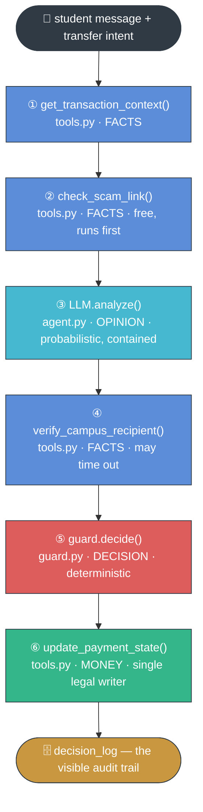
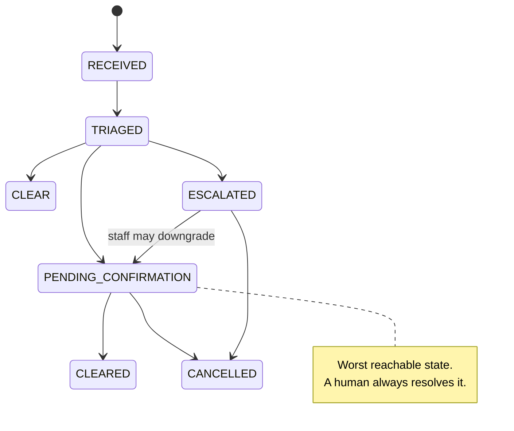

<div align="center">


# 🛡️ Venator

### Campus Wallet & Scam Defense Agent

**An autonomous payment-triage agent for a university campus wallet.**
The model reads the message. The code decides. The human holds the last word.

<br>

[](#)
[](#)
[](#)

[](#)
[](#)
[-35B58A?style=flat-square)](#)
[](#)
[](#-the-dataset)
[](#-the-safety-invariants)
[](LICENSE)
[](#)

<br>

> ### 🔒 The thesis
> **The LLM never gets to move money.**
> The model produces an *opinion* — a risk score, a confidence, a plain-English reason.
> Deterministic Python owns every *decision*. A single guarded writer owns every *state change*.
> Intelligence is probabilistic. **Authority is not.**

<br>

[**Why this exists**](#-why-this-exists) ·
[**Architecture**](#-architecture) ·
[**The rules**](#-the-decision-engine-rules-r1r7) ·
[**Safety**](#-the-safety-invariants) ·
[**Run it**](#-run-it) ·
[**Walkthrough**](#-walkthrough-4-min) ·
[**Dataset**](#-the-dataset) ·
[**Limits**](#-known-limits-stated-honestly)

</div>

---

## 📖 Contents

| | Section | What's in it |
|:--:|---|---|
| 💡 | [Why this exists](#-why-this-exists) | The problem, and why the LLM/authority split is the only defensible answer |
| 🏗️ | [Architecture](#-architecture) | Six stages, four modules, no framework |
| ⚖️ | [The decision engine](#-the-decision-engine-rules-r1r7) | Rules **R1–R7**, first match wins |
| 🔐 | [The safety invariants](#-the-safety-invariants) | Four properties the design guarantees |
| 🚀 | [Run it](#-run-it) | Five commands |
| 🖥️ | [The dashboard](#-the-dashboard) | The operations console |
| 🎬 | [Walkthrough](#-walkthrough-4-min) | Five ways to see it work |
| 📊 | [The dataset](#-the-dataset) | 21 scenarios, 7 of them real |
| ✅ | [Brief checklist](#-what-we-shipped-against-the-brief) | Requirement → status → where |
| 🚁 | [Stretch goals](#-stretch-goals) | What we built on top |
| 🧠 | [Engineering notes](#-engineering-notes) | Design decisions and trade-offs |
| ⚠️ | [Known limits](#-known-limits-stated-honestly) | Stated out loud, on purpose |
| 🗂️ | [Repository layout](#-repository-layout) | Where everything lives |

---

## 💡 Why this exists

Peer-to-peer payment on a campus is a **social problem wearing a technical costume**. The money
moves because a *message* said so — and messages are exactly where fraud lives:

<table>
<tr>
<td width="50%" valign="top">

**🚩 The attack surface**

- ⏰ Manufactured urgency
- 🫥 Scarcity pressure
- 💸 Prices that are too good
- 🔗 Off-platform redirects
- 🔑 Credential requests
- 🎭 "Send it to my cousin instead"
- 👻 Brand-new accounts, zero history

</td>
<td width="50%" valign="top">

**🧩 Three things are true at once**

1. **A human can't read every message.** The scam works because nobody was watching.
2. **An LLM is genuinely good at reading messy human text** — and genuinely unsafe as an authority. It hallucinates. It can be injected. It fails non-deterministically.
3. **Money needs an answer you can defend to a regulator**, not a plausible paragraph.

</td>
</tr>
</table>

So we split the two. The model does what it's good at — *reading*. Code does what it must —
*deciding*. A human is the last resort for anything uncertain.

> 🎯 **The result:** a system that is **autonomous in its judgement** and **auditable in its actions**.

---

## 🏗️ Architecture

Four modules, no framework, no orchestration library — **the state machine is written by hand,
deliberately.** Every arrow below is a real function call, and every one of them writes a row.



**Five facts-or-opinion stages. One authority stage. One writer.** Nothing else can touch a wallet.

| Stage | File | Responsibility | Nature |
|:--:|---|---|:--:|
| ① | `venator/tools.py: get_transaction_context` | load the flagged transaction | 🔵 fact |
| ② | `venator/tools.py: check_scam_link` | known-phishing URL lookup | 🔵 fact |
| ③ | `venator/agent.py: _analyze` | risk, confidence, indicators, reason | 🟡 **opinion** |
| ④ | `venator/tools.py: verify_campus_recipient` | tier, account age, report count | 🔵 fact |
| ⑤ | `venator/guard.py: decide` | the verdict | 🔴 **authority** |
| ⑥ | `venator/tools.py: update_payment_state` | the only legal state mutation | 🟢 money |

### 🔁 The loop guard
`venator/agent.py: triage` — if a transaction is already awaiting a human, already escalated, or
already settled, `triage()` **returns immediately**. No second LLM call. No re-asking. No polling.

State lives in SQLite, so it survives a restart. There is **no daemon, no queue worker, and no
`while True` anywhere in the codebase** — the agent is *called*, it reads the world, it acts, it exits.

### 🩹 The parser
`venator/agent.py: _parse_analysis` — a small local model sometimes truncates its JSON. The parser
repairs unbalanced braces, trims trailing junk, and falls back to regex extraction of the two numbers
it needs. If all of that fails the analysis is `None` — which the guard treats as **no opinion**, not
as **safe**.

> That distinction is the whole design in one line.

---

## ⚖️ The decision engine (rules R1–R7)

`guard.py` is a **pure function** — no I/O, no clock, no randomness, **74 lines**. Rules fire in
order, first match wins, and the matching rule's name is written into the audit trail so a reviewer
can replay the reasoning.

| Rule | Trigger | Verdict | Why |
|:--:|---|:--:|---|
| **R1** | message contains a URL already confirmed as a scam | 🔴 `ESCALATED` | hard fact beats any opinion |
| **R1b** | recipient has ≥2 confirmed scam reports | 🔴 `ESCALATED` | hard fact, repeat offender |
| **R2** | analysis engine unavailable | 🟡 `HOLD` | never guess, never block |
| **R2b** | model confidence < 0.5 | 🟡 `HOLD` | flag uncertainty, don't act on it |
| **R2c** | analysis returned no risk score | 🟡 `HOLD` | missing data is not "safe" |
| **R1c** | unverified recipient **and** risk ≥ 70 | 🔴 `ESCALATED` | fact + confident opinion |
| **R3** | directory service timed out | 🟡 `HOLD` | degrade gracefully, wallet stays open |
| **R4** | risk ≥ 70 | 🔴 `ESCALATED` | clear scam pattern, staff review |
| **R5** | risk 30–69, unverified, > 150 AED | 🔴 `ESCALATED` | the genuinely uncertain middle |
| **R6** | trusted party, risk < 30, ≤ 300 AED | 🟢 `CLEAR` | canteen snacks never wait |
| **R7** | everything else | 🟡 `HOLD` | ask the student, exactly once |

> ### 🔑 Read the ordering. That's the point.
> **Facts (R1, R1b) outrank opinions (R1c, R4, R5).**
> **Uncertainty (R2, R2b, R2c, R3, R7) never resolves to a freeze — it resolves to a question.**

---

## 🔐 The safety invariants

The properties this design guarantees. Each one is enforced by **structure**, not by care.

<table>
<tr>
<td width="33%" valign="top">

### 1️⃣

**There is no `BLOCK` state.**

The state machine has exactly three outcomes, and the schema *literally cannot express* a permanent
freeze.

</td>
<td width="33%" valign="top">

### 2️⃣

**One writer, and it validates.**

`update_payment_state` is the *only* function that mutates `transactions.state`, and it rejects
illegal transitions with `ValueError`.

</td>
<td width="33%" valign="top">

### 3️⃣

**Degradation, not failure.**

Brain dead (R2), brain mumbling (R2b/R2c), directory hanging (R3) — all **modeled states** with
defined behaviour, not crashes.

</td>
</tr>
</table>



<div align="center">

**🚫 There is no `BLOCK` state. It is not policy that funds are never frozen forever — it is arithmetic.**

</div>

- **The LLM has no import path to the writer.** The web layer has no route to it. There is exactly
  one door. 🚪
- **We hit the brain-unavailable path during development** — live, on TX-008 — and the system held
  the transfer and stayed up. Not a demo. The design working. 🛠️
- **4️⃣ No unbounded loop.** Nothing polls. A transaction awaiting a human is never re-triaged, so
  the agent cannot spin, re-ask, or re-bill the model. **LLM calls per transaction: at most one, ever.**

---

## 🚀 Run it

```bash
PY=~/.venv/bin/python          # needs the `openai` package; local model at 127.0.0.1:8080

$PY main.py build              # 🌱 seed the dataset → campus_wallet_logs.sqlite
$PY main.py web                # ⭐ the dashboard → http://127.0.0.1:8401
$PY main.py tests              # 🧪 guard-rule + parser unit tests (no LLM, instant)
$PY main.py demo               # 🎬 scripted 21-scenario run in the terminal
$PY main.py ui                 # ⌨️  original terminal interface (fallback)
```

> 💡 `tests` and `demo` exist so the system can be exercised without a browser or a network — the
> full narrative runs end to end from a terminal with zero dependencies.

---

## 🖥️ The dashboard

`venator/web.py` is **stdlib-only** — `http.server` plus a single embedded HTML page. No build
step. No CDN. No npm. It decides **nothing**; it reads the same SQLite database and calls the same
`VenatorAgent` the terminal does.

<div align="center">

*Same architecture, wearing a product face.* 🎩

</div>

| Feature | What it does |
|---|---|
| 🗂️ **The queue** | every transaction with its live state, filterable and searchable, exactly as a staff reviewer sees it |
| 🔍 **The audit trail** | per transaction, the full chain: 🔵 tool steps (facts), 🟡 LLM step (opinion), 🔴 guard step (decision), 🟢 human step (answer) |
| 📡 **Live streaming** | while the agent works, the board polls the trail and paints each step as it commits — with a pulsing ghost row while the model is reading. **You watch the agent think.** |
| 🙋 **The human moment** | a pending transaction shows *Respond as student*; confirm releases it, cancel stops it and reports the seller |
| 📢 **The broadcast feed** | when a phishing link is confirmed, the alert appears campus-wide, in real time |

> 🎨 **Design note:** the palette is muted and semantic — green clears, amber waits, red escalates,
> never decorative — with focus rings and `prefers-reduced-motion` respected. It's an operations
> console, not a landing page.

---

## 🎬 Walkthrough (~4 min)

<details open>
<summary><b>1️⃣ The brief's own scam — <code>TX-003</code></b></summary>

Open it → **Run agent chain**. The panel fills in live:

- 🔵 the tool reads the facts
- 🟡 the model calls it at **risk 96**, indicator *"fake .top domain"*
- 🔴 the guard escalates under **R1c**

The link is now on the **campus broadcast feed**. 📢

</details>

<details open>
<summary><b>2️⃣ The second student — <code>TX-013</code></b></summary>

Same phishing URL, different sender. **This one never reaches the model** —
`check_scam_link` catches it first and **R1** escalates on the hard fact alone.

> ⚡ The system reacted to a case that happened ten seconds earlier.

</details>

<details open>
<summary><b>3️⃣ Money that needs a human — <code>TX-012</code></b></summary>

800 AED for a laptop share, all above board. Chain → 🟡 `PENDING_CONFIRMATION`.

The guard will not auto-clear 800 AED, and the model can't make it. **A person does.**

Hit **Respond as student** → confirm → 🟢 `CLEARED`.

</details>

<details open>
<summary><b>4️⃣ Any message, live</b></summary>

Any message that arrives — including one typed into the box while the system is open — runs the
real chain and escalates with a plain-English reason. Nothing is scripted, nothing is mocked up:

> *"selling front row fest pass 50 aed!! send to @campus_tix_99 fast https://venator-claims.top/tix"*

</details>

<details open>
<summary><b>5️⃣ The loop guard — triage <code>TX-003</code> again</b></summary>

Instead of re-asking, the **loop-guard** step appears: state is already `ESCALATED`, no second model
call. The "no infinite loops / no repeated questioning" requirement, demonstrated rather than
asserted.

</details>

---

## 📊 The dataset

`venator/db.py` builds `campus_wallet_logs.sqlite` — the schema, the 21 scenarios, the recipient
directory (tiers, account ages, report counts), the scam-link registry, the broadcast feed, and the
decision log.

<div align="center">

| 📝 Authored | 🌐 Real (mined) | 🎯 Total |
|:--:|:--:|:--:|
| **14** | **7** | **21** |
| full rule-surface coverage | UCI SMS Spam Collection | every rule exercised |

</div>

- **14 authored scenarios** — canteen auto-clears, the brief's exact ticket scam, credential
  phishing, a repeat offender, low-confidence slang, three genuinely uncertain mid-risk cases, a
  **directory outage**, and both human resolutions.
- **7 real messages mined from the [UCI SMS Spam Collection](https://archive.ics.uci.edu/dataset/228/sms+spam+collection)**
  (`venator/miner.py`) — the open dataset the brief recommends — pulled into the same pipeline.
  **All 7 real scams escalate.** ⚠️

> 🏷️ Sample data is synthetic and labelled as such in the UI. The mined corpus is public research data.

---

## ✅ What we shipped against the brief

| Requirement | Status | Where |
|---|:--:|---|
| ≥10 scenarios | ✅ **21** | `db.py: SCENARIOS` + `miner.py` |
| Visible decision log, ≥3 steps per case | ✅ chain per txn, typically **5–7 steps** | `db.py: decision_log`, web chain panel |
| Human confirmation of uncertain payments | ✅ pending → human answers once → resolved | `agent.resolve`, web modal |
| Stateful memory (no re-asking) | ✅ loop guard, SQLite-persisted | `agent.triage` |
| Graceful degradation on service failure | ✅ R2 / R2b / R2c / R3 | `guard.py` |
| Never permanently freeze a wallet | ✅ **no `BLOCK` state exists** | `tools.update_payment_state` |
| LLM vs deterministic separation | ✅ opinion vs authority vs writer | whole architecture |
| Three mock services | ✅ context, directory, state writer | `tools.py` |

### 🚁 Stretch goals

- **📢 Automatic scam-alert broadcast** — a confirmed phishing URL is registered and pushed to a
  campus feed; the next student to receive the same link is caught by URL *before the model is
  invoked*. **Demonstrated live by the TX-003 → TX-013 pair.**
- **⏱️ Staff hours saved** — every auto-cleared transfer is quantified on the dashboard header. The
  assistant's worth, in the units a school actually cares about.
- **🎲 Live ad-hoc triage** — any message that arrives runs the real agent chain.

---

## 🧠 Engineering notes

**🎯 Opinion at the edges, authority in the middle.**
The model sits inside a bounded box: it receives a formatted prompt, returns JSON parsed
defensively, and its output can only ever reach `guard.decide` as **one argument**. It cannot call
tools. It cannot choose actions. It cannot write state. The worst a hallucinating or
prompt-injected model can do is produce a *wrong opinion* — which the deterministic rules are
already written to distrust when confidence is low.

**🧯 Fail soft, log everything.**
Every non-happy path writes its reason into the audit trail *before* the verdict lands: parser
failure, engine outage, directory timeout. A reviewer never has to guess why a transfer was held.

**🧱 Boring where it counts.**
No framework. No ORM. No async. No orchestration library. SQLite and stdlib. The parts that matter —
rules, state machine, single writer — are **short enough to read in one sitting**, which is the point.

---

## ⚠️ Known limits, stated honestly

| Limit | Detail |
|---|---|
| 🎭 **Synthetic directory** | the recipient tiers and report counts are local mocks |
| 🔤 **Exact-string link matching** | a typosquat evades it until it's been seen once |
| 📏 **Untuned thresholds** | `300 / 150 / 70 / 0.5` are defensible, not tuned on real fraud data |
| 🧪 **Local model** | the LLM is a local mock endpoint, not a production inference service |

> ✅ Everything else — the separation, the state machine, the loop guard, the fallbacks — is
> **production-shaped as-is.**

---

## 🗂️ Repository layout

```
📦 venator
├─ 🚀 main.py                 launcher: build | web | tests | demo | ui
├─ 📁 venator/
│  ├─ 🧠 db.py                schema + 21 scenarios + recipient directory (the dataset brain)
│  ├─ ⛏️ miner.py             mines 7 real messages from the UCI SMS Spam Collection
│  ├─ 🔧 tools.py             the 3 mock services + scam-link feed; the state machine lives here
│  ├─ 🤖 agent.py             the triage loop, the defensive JSON parser, the loop guard
│  ├─ ⚖️ guard.py             R1–R7, pure function, the ONLY decider
│  ├─ 🖥️ web.py               operations dashboard (stdlib http.server + one HTML page)
│  ├─ ⌨️ ui.py                terminal fallback interface
│  ├─ 🎬 demo.py              scripted 21-scenario end-to-end run
│  └─ 🧪 tests.py             12 unit tests: guard rules + parser repair
├─ 📁 capri/
│  ├─ 🔌 openai_lib.py        ModelHouse — thin streaming client for the local model
│  └─ 🗝️ session.py           session id handling
├─ 📁 data/
│  └─ 📊 SMSSpamCollection    the UCI SMS Spam Collection (public research dataset)
└─ 📘 CODE_GUIDE.md           the defence cheat-sheet: rules, state machine, trick questions
```

---

<div align="center">

### 🛡️ TechX Dubai '26 — Domain 1: FinTech Fraud & Compliance

*Every number in this README and every line the dashboard prints comes from a live run of this code
against the local model.*

**Nothing on screen is a mock-up. Nothing is hard-coded for the output.**

<br>

[](#)

<sub>New here? The <a href="#-walkthrough-4-min">walkthrough</a> shows the system working in five steps.</sub>

</div>
